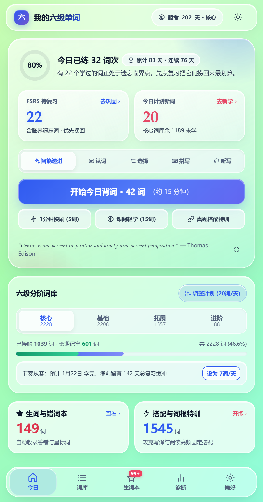
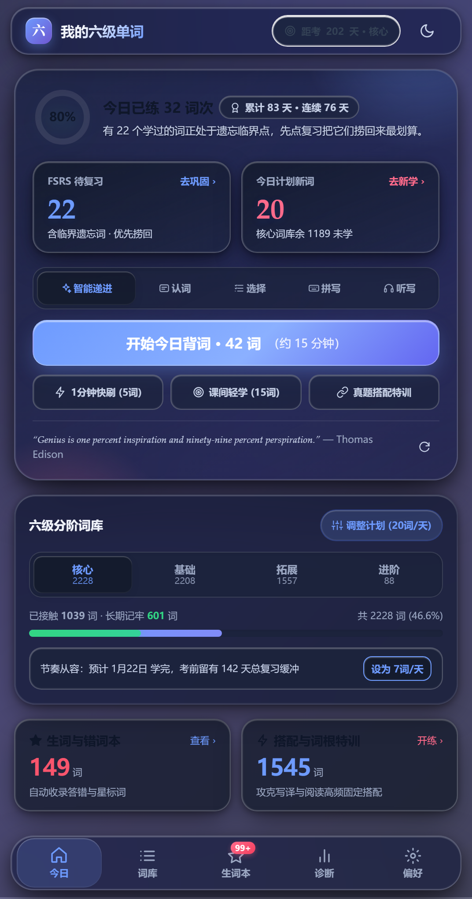
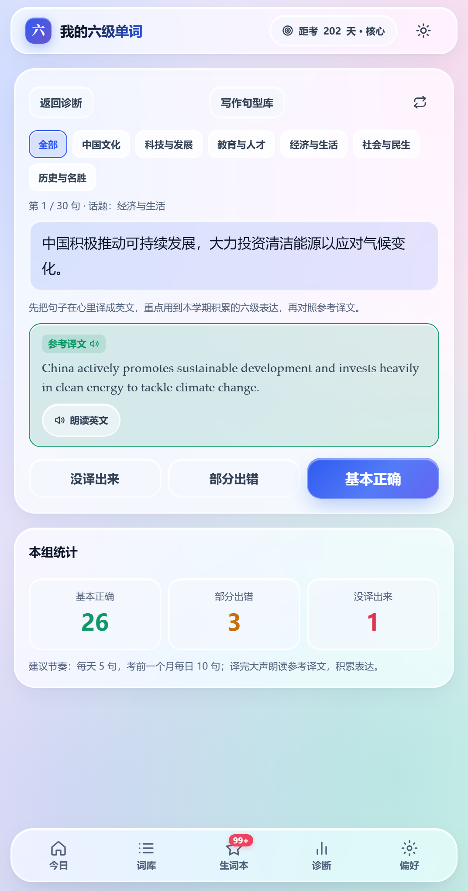
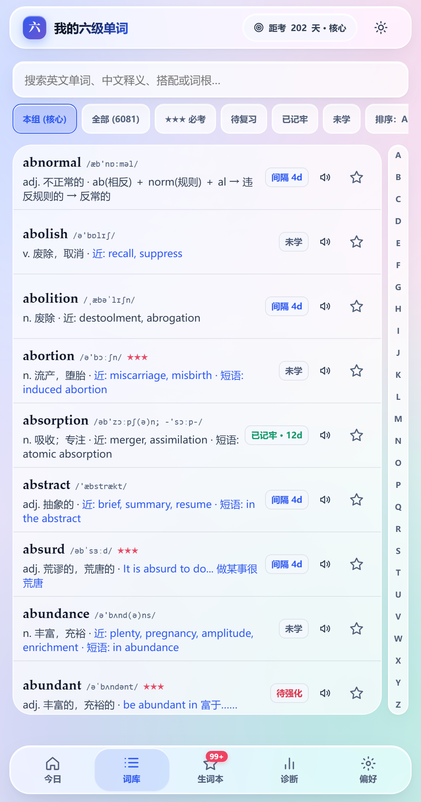
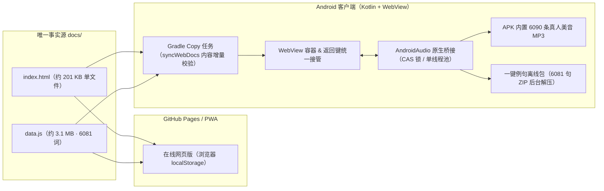

<div align="center">

# 📚 我的六级单词 · CET-6 Offline Mastery

**专为「六级 600 分」冲刺打造的纯粹离线背单词应用**

*真 FSRS-6 幂律遗忘算法 · 6081 词真题例句全带中译 · 6090 条真人美音随包内置 · 单文件网页版与 Android APP 完全同源*

<p>
  <a href="https://github.com/wcx1208/cet6-words/stargazers">
    
  </a>
  <a href="https://github.com/wcx1208/cet6-words/releases/latest">
    
  </a>
  <a href="https://github.com/wcx1208/cet6-words/releases">
    
  </a>
  
  
  
  <a href="LICENSE">
    
  </a>
</p>

**[🌐 网页版秒开体验](https://wcx1208.github.io/cet6-words/) · [📲 下载最新正式签名 APK](https://github.com/wcx1208/cet6-words/releases/latest) · [📸 界面画廊](#-界面预览深浅双态--液态玻璃) · [🔬 算法与架构](#-双端同源工程架构) · [📋 更新日志](CHANGELOG.md)**

</div>

---

## 📸 界面预览（深浅双态 · 液态玻璃）

> 全部截图基于最新版真实渲染 · 支持浅色护眼玻璃 / 午夜深空深色 / 6 套内置渐变壁纸 / 自定义相册背景（全屏高对比适配）

<div align="center">

<table>
  <tr>
    <td align="center" width="25%">
      <br/>
      <sub><b>今日主舞台（浅色壁纸）</b><br/>双环完成度 · 记忆调度面板</sub>
    </td>
    <td align="center" width="25%">
      <br/>
      <sub><b>午夜墨蓝（深色模式）</b><br/>暗光夜读 · 高对比护眼</sub>
    </td>
    <td align="center" width="25%">
      <br/>
      <sub><b>沉浸式学词舞台</b><br/>真题语境挖空 · FSRS 实时预估</sub>
    </td>
    <td align="center" width="25%">
      <br/>
      <sub><b>全维词卡解析与辨析</b><br/>词性彩色胶囊 · 词根 · 易混对比</sub>
    </td>
  </tr>
</table>

<table>
  <tr>
    <td align="center" width="33%">
      <br/>
      <sub><b>600 分战力诊断 &amp; FSRS-6 曲线</b><br/>里程碑进度轴 · 90% 留存曲线 · 12 周热力图</sub>
    </td>
    <td align="center" width="33%">
      <br/>
      <sub><b>六级汉译英专题特训</b><br/>6 大真题高频话题 · 30 句对照自评与朗读</sub>
    </td>
    <td align="center" width="33%">
      <br/>
      <sub><b>6081 词 A–Z 极速检索</b><br/>82px 虚拟滚动零卡顿 · 考频 / 易错筛选</sub>
    </td>
  </tr>
</table>

</div>

---

## ✨ 为什么还要再做一个背单词工具？

市面上的商业背词应用，往往把精力花在**开屏广告、强制社交打卡、每日弹窗买会员、以及把你的学习记录锁死在云端账号里**。

这个开源项目来自一个无比真实的个人需求——**作者本人从大学英语六级 345 分（听力 109 / 阅读 109 / 写译 127）备考冲刺 600 分，全程写给自己每天刷词使用**。因此每一行代码只服务三件事：**零打扰打开就背、数学上最科学的复习节奏、上考场直接用得出的输出能力**。

| 对比维度 | 商业背单词 App（常见痛点） | 本项目 `cet6-words` |
| :--- | :--- | :--- |
| **广告与账号** | 开屏广告、弹窗会员、必须手机号登录 | **0 广告 · 0 登录 · 0 跟踪上报**，开源代码透明可查 |
| **离线可用性** | 断网就加载转圈、离线词库音频常付费解锁 | **内置 6090 条真人美音** + 一键离线包（6081 句），飞行模式全功能运行 |
| **复习算法** | 自创不透明伪间隔或老旧 SM-2 固定倍数 | **纯正 FSRS-6**（21 参数幂律遗忘曲线），按 `S` 与 `D` 精准踩点 90% 留存线 |
| **考场实战度** | 只给孤立中释与机器短句，背完仍不会做题 | **真题语境挖空预热 + 全句中译 + 30 句翻译特训 + 26 条高分写作句型** |
| **数据主权** | 换工具进度清零、不提供结构化完整导出 | **本机 `localStorage` 完全掌控** + 损坏缓存自动转存抢救 + 原子校验 JSON 备份 |
| **工程体量** | 动辄几百 MB 安装包与重型前端框架 | 前端仅 **`201 KB` 单文件 HTML** + **`3.1 MB` 词库**，无任何外部 CDN 依赖 |

---

## 🚀 核心功能全景

| 模块 | 硬核能力 |
| :--- | :--- |
| 🧠 **FSRS-6 记忆调度** | 完整实现 [FSRS-6](https://github.com/open-spaced-repetition/py-fsrs)（21 个默认权重参数）：为每个单词独立计算稳定性 `S`、难度 `D` 与可提取性 `R(t)`，动态瞄准 **90% 保持率**安排复习；`v3.8.1` 修复模糊档位自锁、增加熟知曲线平滑防过跳与 `180d` 上限保护，完全兼容旧版 SM-2 迁移。 |
| 📚 **6081 词四阶词库** | 精准分层：**核心 2228 / 基础 2208 / 拓展 1557 / 进阶 88**；全部词条拥有 **100% 真题/高质量例句与地道中文翻译**、规范化多词性彩色胶囊释义、英文释义、词根助记、考场搭配与词库内可点按发声的易混辨析。 |
| 🎴 **四题型 + 智能递进** | 支持 **卡片认词 / 释义选择 / 拼写默写 / 听音默写**；「智能递进」模式根据单卡 FSRS 阶段自动派发最合适题型——初见认词预热 → 巩固期四选一 → 熟词拼写强化；拼写报错带 **LCS 逐字母 Diff 高亮** + 跟打肌肉记忆强化。 |
| ✍️ **写译专项突破** | **翻译特训**：覆盖中国文化、科技发展、教育人才、经济生活、社会民生、历史名胜六大六级高频题材共 **30 句**中译英对照训练与三档统计；**写作句型库**：5 大段落结构共 **26 条高分模板** + **15 组高分词替换表**。 |
| 🔊 **双离线音频引擎** | Android 端直接播放内置 `assets/audio/us/` **6090 条 56kbps 真人美音 MP3**（100% 覆盖 6081 词）；可选在偏好页一键下载 **6081 句全覆盖例句离线语音包**（`v3.8.1` 全量同步重建，约 70 MB），断网也能流畅听读整句。 |
| 📊 **600 分战力诊断** | 实时预估词汇支撑分（`345 → 480 → 550 → 600` 发光里程碑轴）· 三阶段备考规划 · FSRS 遗忘曲线（含 90% 黄金线与刻度）· 近 12 周学习热力图 · 近 7 日柱状图 · **顽固错词 Top 10 一键靶向清零**。 |
| 🎨 **液态玻璃与个性定制** | 液态毛玻璃高光容器、内置 6 套渐变壁纸 + 手机相册选图（多级自适应压缩存储于独立 `wall_img` 键）、双透明度滑杆、暖光/深空双态主题、Web Audio API 零体积实时合成清脆音效、177 条严格校订英文名言。 |
| 🛡️ **三重数据安全防护** | ① **损坏留存抢救**：缓存异常时不静默清零，自动转存至 `*_corrupt_<时间戳>` 并提供设置页导出按钮；② **配额满红条告警**：任一键写入失败即挂起顶部常驻红色提醒栏并支持一键备份；③ **安全原子导入**：对全部字段做范围与原型污染校验，展示覆盖词数二次确认并在替换前自动留存 `backup_pre_import`。 |

---

## 🔬 双端同源工程架构

一套零外部依赖的纯静态前端驱动两个平台：**GitHub Pages 网页版直接托管 `docs/`**，Android 客户端通过极简 **原生 WebView + `AndroidAudio` JS Bridge** 加载同源产物，Gradle 构建期自动校验内容快照同步，彻底消除双端分叉。



---

## 📲 下载与使用指南

### 方式一：下载安装 Android APK（推荐）

前往 **[GitHub Releases 最新版](https://github.com/wcx1208/cet6-words/releases/latest)** 下载正式签名安装包 **`mywords-v3.8.1.apk`**（Android 8.0+，约 41 MB，内含全套 6090 条离线美音 MP3）。

> **签名与无损升级提示**：
> `v3.7` 起已启用正式发布签名（`CN=wcx1208`）。`v3.7` / `v3.8` 用户直接下载 `mywords-v3.8.1.apk` **同签名覆盖安装**即可，学习进度与离线语音包自动保留；若你当前使用的是 `v3.6.3` 或更早的调试签名版，请先在「偏好设置 → 导出进度到剪贴板」备份 JSON，卸载旧版后再安装新版导入恢复。

安装完成后如需在完全无网环境下点读真题例句，可在应用内 **偏好设置 → 语音包与发音隐私 → 下载整包**，一键后台拉取并与新版词库 **6081/6081 句 100% 对齐**的例句离线包。

### 方式二：网页版秒开（桌面 / iOS / 浏览器 PWA）

直接访问 **[https://wcx1208.github.io/cet6-words/](https://wcx1208.github.io/cet6-words/)** ，零等待开刷；手机浏览器可点击「添加到主屏幕」，也可直接下载 `docs/index.html` 与 `docs/data.js` 到本地目录离线双击使用。

---

## 🔒 隐私与数据主权说明

1. **本地存储零上报**：所有 FSRS-6 记忆曲线（`srs`）、每日学习统计（`hist`）与偏好配置（`cfg`）完全保存在本机 `localStorage` 中，**无注册登录、无广告 SDK、无任何后台数据采集**。
2. **可选「严格纯离线模式」**：
   - Android 端词汇发音始终优先播放随包内置离线美音；安装例句语音包后，例句同样本地播放。
   - 在偏好设置页可随时切换 **「联网兜底发音」开关**：关闭后，应用会严格拦截一切有道（`dict.youdao.com`）与百度（`fanyi.baidu.com`）TTS 请求，真正实现零外发请求运行。
3. **Android 系统备份透明说明**：`AndroidManifest.xml` 默认保留 `allowBackup="true"`，可在系统换机助手或厂商云备份中迁移本机进度；如需在 Android 与网页版之间跨端转移进度，使用偏好页的 JSON 导入/导出即可。

---

## 🖨 配套打印资料与致谢来源

配合 APP 每日刷词使用的两份排版打印手册随项目离线分发（仓库外）：
**《六级核心词汇全程手册》**（三级分级精记 649 记忆单元 + 详解 300 / 速刷 500 同源词表）与 **《六级 345 到 600 全程作战手册》**（三阶段冲刺任务 + 分题型攻略 + 打卡日历）。

| 开源项目 / 数据源 | 在本项目中的用途 | 原始许可 |
| :--- | :--- | :--- |
| [open-spaced-repetition/py-fsrs](https://github.com/open-spaced-repetition/py-fsrs) | FSRS-6 21 参数幂律记忆算法数学模型 | MIT |
| [kajweb/dict](https://github.com/kajweb/dict) | 六级核心词书词义、真题例句与词根记忆基础语料 | — |
| [skywind3000/ECDICT](https://github.com/skywind3000/ECDICT) | 英文释义、柯林斯星级、BNC 词频与考纲标签 | MIT |
| [Tatoeba](https://tatoeba.org) | 高频地道例句增补与语境对齐 | CC-BY |

---

## 🛠 开发者：测试与本地构建

仓库已配备面向 `index.html` 与 `data.js` 的全自动回归测试套件及目录工程结构：

- `docs/`：**唯一网页源码与资产目录**（直接部署为 GitHub Pages，Gradle 自动同步至安卓工程）
- `app/`：Android 原生容器（`MainActivity.kt`、`assets/audio/us/` 内置美音）与 `build.gradle.kts`
- `test/fsrs.test.mjs`：覆盖 FSRS-6 连续 Hard/Again/Good/Easy 曲线、间隔饱和、旧版迁移、`safeLoad` 损坏备份、`saveFailed` 告警、`importP` 恶意注入拦截与静默零外链检查
- `legacy-compose/`：v2.x 纯 Jetpack Compose 原生界面时期历史归档参考（已冻结不参与构建）
- `CHANGELOG.md`：完整版本演进与每轮审查修正明细

```bash
# 运行 FSRS-6 算法与存储安全自动化测试（Node.js 18+）
node test/fsrs.test.mjs

# 从源码构建 Android APK（需本地 JDK 17 与 Android SDK 34）
./gradlew syncWebDocs assembleRelease
```

---

<div align="center">

**如果这个纯粹、无广告、为你省下无数时间的六级开源项目帮到了你，欢迎右上角点亮一颗 ⭐ Star！**

*祝每位备考者六级稳过 600+，如愿上岸 🎯*

[MIT License](LICENSE) · 词库原始语料版权归各数据源所有，仅用于个人学习用途

</div>
