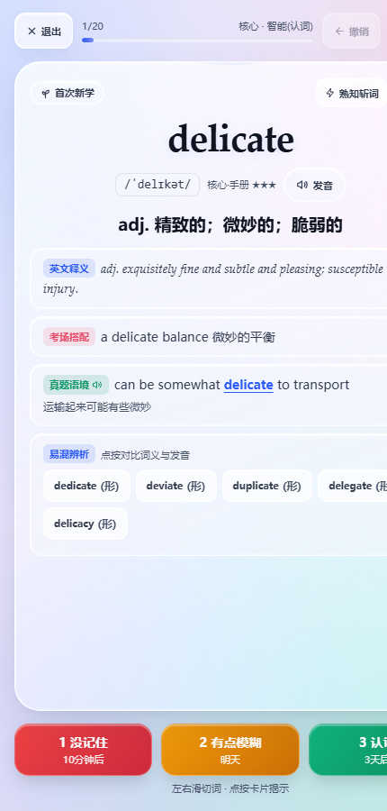
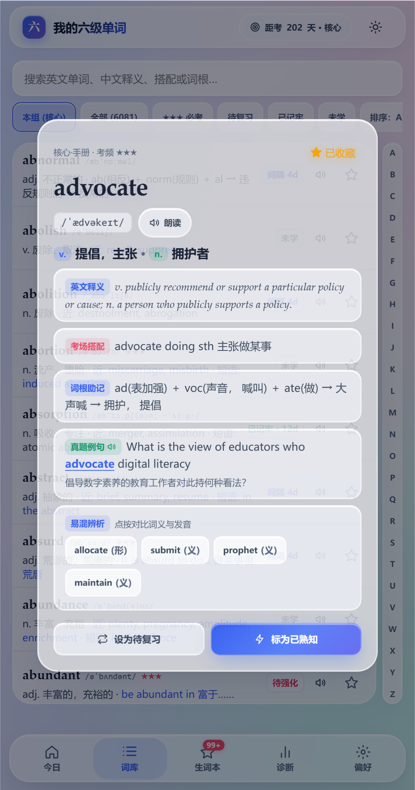
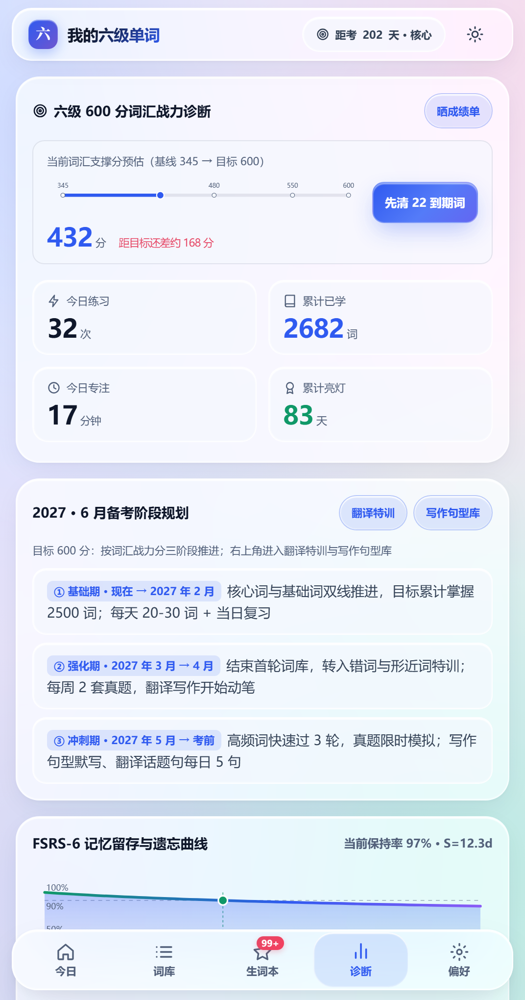

# 📚 我的六级单词

**为「六级 600 分」打造的离线背单词应用 · 安卓 APP 与网页版，同一套代码**

**[📲 下载安卓 APP](#-下载安装安卓) · [🌐 网页版直接用](https://wcx1208.github.io/cet6-words/) · [🖨 配套打印资料](#-配套打印资料)**

<table>
<tr>
<td></td>
<td></td>
<td></td>
</tr>
<tr>
<td></td>
<td></td>
<td></td>
</tr>
</table>

*全套界面支持深浅色 · 真机截图*

---

## ✨ 为什么做这个

市面上的背单词应用：要么强制联网、要么塞广告、要么把你的学习进度锁在自家账号里。

这个项目为**一个真实目标**而生：作者本人从六级 345 分（听力 109 / 阅读 109 / 写译 127）备考 600 分，全程自用。所以它是这样设计的：

- **6 秒打开，飞行模式照常学** —— 6081 词、6090 条真人美音、例句发音全部内置，无广告无登录
- **进度永远在你手里** —— 数据存本地，一键导出 JSON 备份，换手机不丢
- **每一个功能都能回答"对考场上分有什么用"** —— 翻译特训对应翻译题、写作句型库对应作文、真题例句对应阅读

## 🚀 功能速览

| 模块 | 能力 |
|---|---|
| 🧠 **记忆调度** | 真 [FSRS-6](https://github.com/open-spaced-repetition/py-fsrs)（21 参数幂律遗忘曲线）：每个词精确维护记忆稳定性 S 与难度 D，在快忘时安排复习 |
| 📚 **词库** | 6081 词 · 四级难度分组（核心 2228 / 基础 2208 / 拓展 1557 / 进阶 88）· 例句 **100% 带中文翻译** · 英文释义 93.6% · 易混辨析 93.8% · 词根记忆法 · 考场搭配 |
| 🎴 **四种模式 + 智能递进** | 卡片认词 / 释义选择 / 拼写默写 / 听写；智能模式按每个词的记忆阶段**自动配题**（新词→语境认词，巩固→四选一，熟悉→拼写） |
| ✍️ **翻译特训** | 30 句六级高频话题训练句（中国文化/科技/教育/经济/社会/名胜六类），中译英自评三档，进度持久化 |
| 📝 **写作句型库** | 图表描述/引出话题/观点论证/让步转折/结论建议五类功能句型 + 高分词替换表 |
| 🔊 **发音** | 6090 条内置真人美音 → 在线有道 → 百度 TTS；**例句 6079 句离线发音包**一键下载 |
| 📊 **统计诊断** | 600 分词汇战力实时预估（满掌握 = 600）· FSRS 记忆存留曲线 · 12 周热力图 · 错词 Top 10 · 三阶段备考规划 |
| 🎨 **个性化** | 6 套渐变壁纸 + 相册自定义（应用内压缩）· 壁纸强度/卡片不透明双滑杆 · 深浅色主题 · 177 条英文名言 |
| 🔄 **数据自主** | 学习进度导出/导入 JSON · 收藏 · 标熟知 · 撤销栈 · 跨天不断学 |

## 📲 下载安装安卓

**[前往 Releases 下载最新 APK](https://github.com/wcx1208/cet6-words/releases/latest)** · Android 8.0+ · 约 41 MB

安装时提示"未知来源应用"选择允许即可；同包名覆盖升级，学习进度自动迁移。

> 也可以直接用 [网页版](https://wcx1208.github.io/cet6-words/)（手机浏览器"添加到主屏幕"），与 APP 同一套界面，进度各自独立存储。

## 🖨 配套打印资料

配合 APP 使用的两份打印手册（仓库外，随项目一起分发）：

- **《六级核心词汇全程手册》** —— 三级分级精记 649 记忆单元 + APP 同源高频词表（详解 300 + 速刷 500）
- **《六级 345 到 600 全程作战手册》** —— 三阶段作战计划、分题型提分攻略、逐周任务、打卡日历与精听/错题工具页

## 🔬 数据与算法

| 来源 | 用途 | 许可 |
|---|---|---|
| [kajweb/dict](https://github.com/kajweb/dict) | 开源六级词书数据（释义 / 真题例句 / 记忆法） | — |
| [ECDICT](https://github.com/skywind3000/ECDICT) | 英文释义 · 柯林斯星级 · BNC 词频 · 考纲标签 | MIT |
| [Tatoeba](https://tatoeba.org) | 例句补充 | CC-BY |
| [py-fsrs](https://github.com/open-spaced-repetition/py-fsrs) | FSRS-6 复习算法参考 | MIT |

<b>记忆算法细节（点开）</b>

移植 FSRS-6 的 21 个默认权重参数，每个词维护：

- **稳定性 S**：记忆保留率从 100% 衰减到 90% 所需的天数
- **难度 D**：1–10，由你的历史评分动态调整
- **可提取性 R**：`R(t) = (1 + FACTOR·t/S)^DECAY`，在 R 逼近 90% 时安排下一次复习

评分四级（记错 / 模糊 / 认识 / 简单），分别对应重学、间隔缩放与稳定性增长曲线。

## 🛠 工程亮点

- **单文件零依赖**：整个应用是一个 158KB 的 `index.html` + 一个 `data.js`，安卓端为 WebView 外壳（APK 41MB，其中 38MB 是发音音频）
- **两端同源**：`docs/` 是唯一改动源，Gradle 构建期自动同步进 APK 的 assets
- **经过三轮独立审查**：Node VM 测试台驱动 12 个场景（背词持久化 / 撤销边界 / 会话恢复 / 跨天 / FSRS 边界 / 6081 词逐词选项生成）全部通过
- **并发安全**：下载 CAS 抢锁、AtomicInteger 计数、单线程任务池、音频焦点管理

## 🗺 Roadmap

- [ ] 真题听力逐句精听模式
- [ ] 词根词缀图谱浏览
- [ ] 拼写模式接入例句语境

## 🤝 贡献

发现 Bug 或有功能想法，欢迎 [提 Issue](https://github.com/wcx1208/cet6-words/issues)！如果这个项目帮到了你，**点一个 Star 就是最好的鼓励** ⭐

## 📄 许可

[MIT](LICENSE) · 词库数据版权归各自数据源所有，仅用于学习用途
